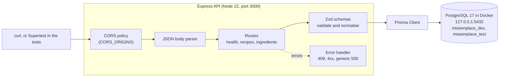
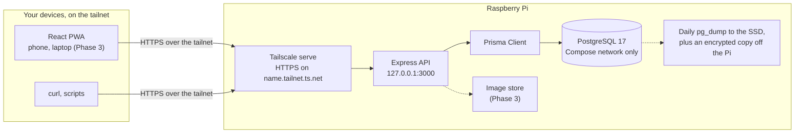

# Architecture

How the pieces connect: first in development today (Phase 1), then on the Raspberry Pi from Phase 2. GitHub draws the diagrams; in an editor, they need a Mermaid preview.

## Phase 1: development

- Every request passes through the CORS policy and the JSON parser, then a route. The route validates its input with a Zod schema before any database call.
- Requests reach the database only through Prisma. Fuzzy search uses Prisma's `$queryRaw` for its trigram SQL.
- The database is published on 127.0.0.1 only. The tests use `miseenplace_test`, and a guard refuses to reset any other database.

## From Phase 2: the Raspberry Pi

- Only `tailscale serve` is reachable from other devices, and only over the tailnet. The same `https://…ts.net` address works at home and away, so the PWA has one origin and HTTPS everywhere (F1).
- The API listens on 127.0.0.1, and the database has no published port at all.
- Electron isn't shown: decision D7 (at the Phase 3 gate) recommends dropping or deferring it in favour of the installed PWA.
