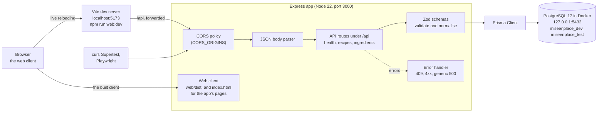
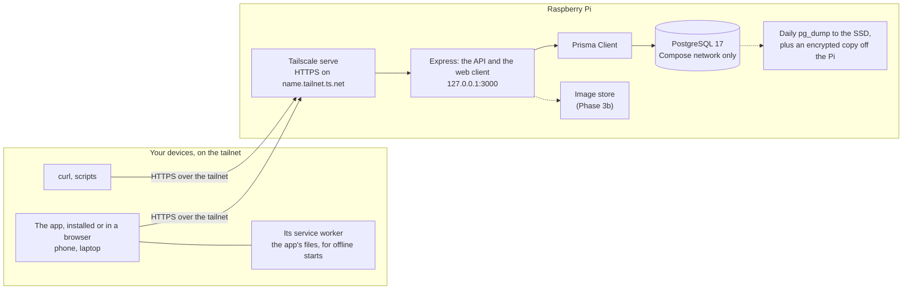

# Architecture

How the pieces connect: in development, then on the Raspberry Pi. GitHub draws the diagrams; in an editor, they need a Mermaid preview.

## Development

- Every API request passes through the CORS policy and the JSON parser, then a route. The route validates its input with a Zod schema before any database call.
- Requests reach the database only through Prisma. Fuzzy search uses Prisma's `$queryRaw` for its trigram SQL.
- After the API routes, the same Express app serves the built client (`src/middleware/web-client.ts`). Files with a hash in their name are cached for a year; `index.html` and the service worker are revalidated every time. Any other page address that wants HTML gets `index.html`, so a link to `/recipes/<id>` opens the app there.
- Vite's dev server forwards `/api` to port 3000, so the client is same-origin in development too, and never needs CORS.
- The database is published on 127.0.0.1 only. The tests use `miseenplace_test`, and a guard refuses to reset any other database.

## From Phase 2: the Raspberry Pi

- Only `tailscale serve` is reachable from other devices, and only over the tailnet. The same `https://…ts.net` address works at home and away, so the app has one origin and HTTPS everywhere (F1). Installing it and its service worker both need HTTPS.
- The API listens on 127.0.0.1, and the database has no published port at all.
- The service worker keeps the app's own files on each device, so the app opens without a connection. Recipes still come from the API until 3c adds an offline copy. A new deploy takes over the next time the app starts.
- There's no Electron app: decision D7 dropped it, and the installed app covers the phone and the laptop.
