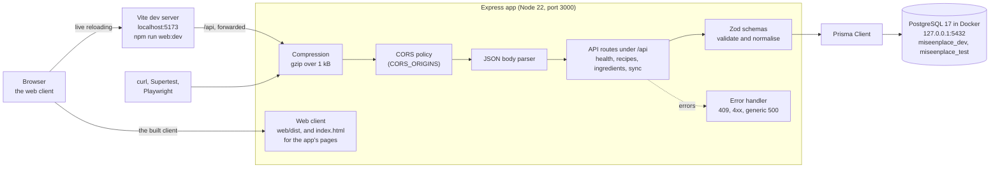
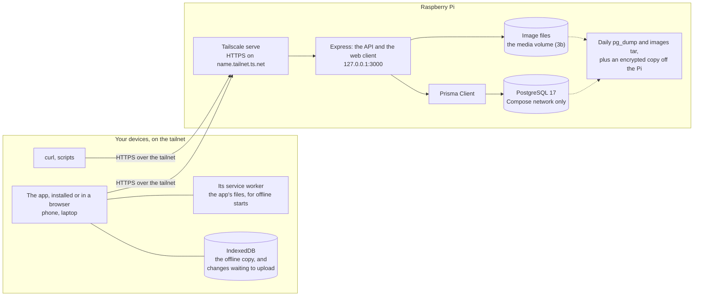
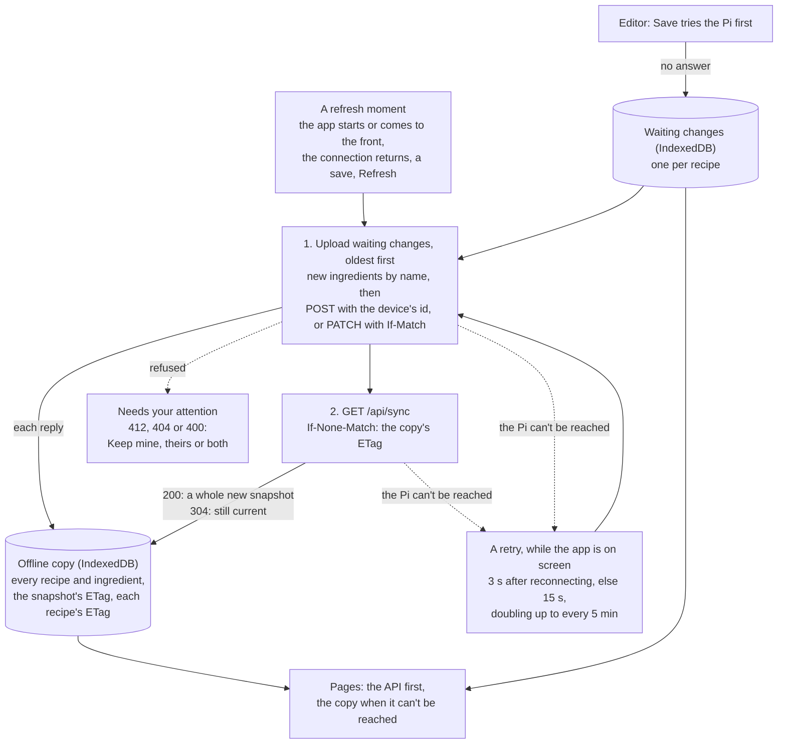

# Architecture

How the pieces connect: in development, then on the Raspberry Pi, then how a device works offline. GitHub draws the diagrams; in an editor, they need a Mermaid preview.

## Development

- Every response over 1 kB is gzipped when the request allows it, the client's files included (3c).
- Every API request passes through the CORS policy and the JSON parser, then a route. The route validates its input with a Zod schema before any database call.
- Requests reach the database only through Prisma. Fuzzy search uses Prisma's `$queryRaw` for its trigram SQL.
- After the API routes, the same Express app serves the built client (`src/middleware/web-client.ts`). Files with a hash in their name are cached for a year; `index.html` and the service worker are revalidated every time. Any other page address that wants HTML gets `index.html`, so a link to `/recipes/<id>` opens the app there.
- Vite's dev server forwards `/api` to port 3000, so the client is same-origin in development too, and never needs CORS.
- The database is published on 127.0.0.1 only. The tests use `miseenplace_test`, and a guard refuses to reset any other database.

## From Phase 2: the Raspberry Pi

- Only `tailscale serve` is reachable from other devices, and only over the tailnet. The same `https://…ts.net` address works at home and away, so the app has one origin and HTTPS everywhere (F1). Installing it and its service worker both need HTTPS.
- The API listens on 127.0.0.1, and the database has no published port at all.
- The service worker keeps the app's own files on each device, so the app opens without a connection, and the offline copy (below) has the recipes. A new deploy takes over the next time the app starts.
- There's no Electron app: decision D7 dropped it, and the installed app covers the phone and the laptop.
- Recipe images (3b) are WebP files the API writes into the `media` volume, after re-encoding every upload with sharp (D11), and serves under `/media`. The database holds a row for each, named by the same id as its files, so a backup is a pair: the dump, and a tar of the volume taken at the same moment.

## From Phase 3c: working offline

- **The snapshot (D8):** `GET /api/sync` returns every recipe and ingredient, and each recipe's ETag, sorted so the same data always gives the same bytes. Its own ETag is a hash of them, so an unchanged copy costs a 304 with no body.
- **The copy** is kept in IndexedDB and never expires. Only a complete new snapshot replaces it, so a failed refresh leaves the device with what it had. Pages ask the API first, and read the copy only when the API can't be reached, with a banner giving its age; search then runs on the device.
- **Saving (D15):** Save tries the Pi first. If it can't be reached, the change waits on the device, at most one per recipe, shown at once and marked as waiting. New recipes get their id on the device.
- **Uploading** happens at the start of each refresh, before the snapshot. If an upload's answer is lost, the retry reads the recipe back, so it's never created twice or saved over a change made on another device. A change that meets one (412), a recipe deleted elsewhere (404), or a refusal (400) waits for you to choose.
- **Still online only:** deleting a recipe, and renaming or deleting an ingredient.
- **What the browser keeps:** the copy and the waiting changes live in the browser's storage for the site. Protect, in Options, asks the browser not to clear them for space; clearing the site's data removes them ([deployment.md](deployment.md#8-installing-the-app-on-your-phone)).
