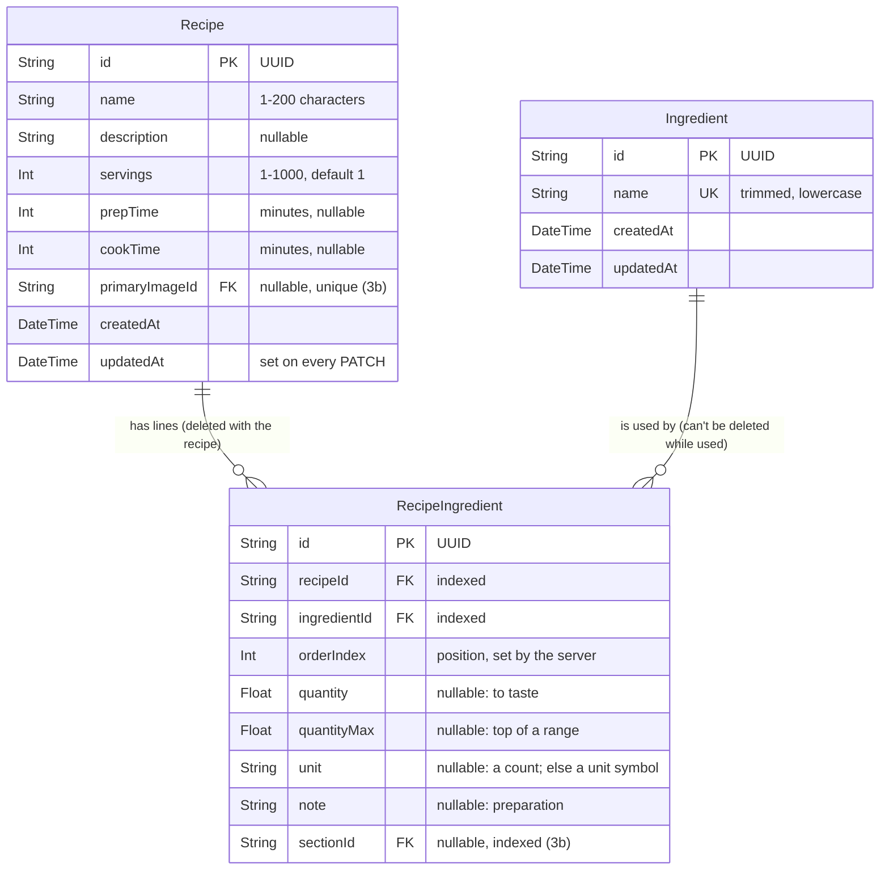
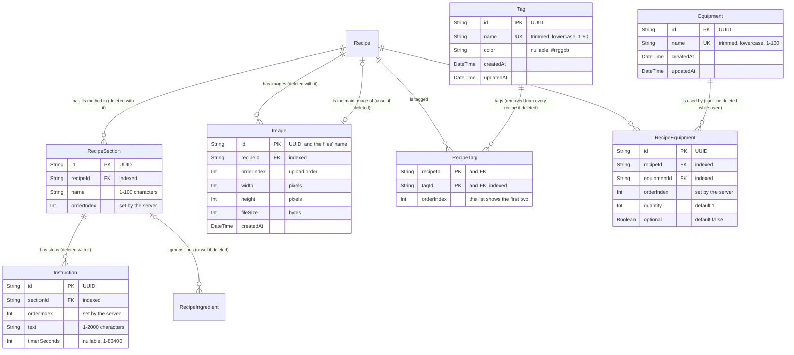

# Database schema (ERD)

The schema in `prisma/schema.prisma`: Phase 1's tables, and Phase 3b's. Phase 1's `Recipe.instructions`, the method as text, became each recipe's "Method" section in 3b, and was then dropped. GitHub draws the diagrams below; in an editor, they need a Mermaid preview. The reasons behind each field are in the technical spec, §2.1 and §2.3.

## Phase 1: recipes, ingredients and lines

- `PK` is the primary key, `FK` a foreign key, and `UK` a unique column.
- A recipe has any number of lines, and each line uses one ingredient. The same ingredient can appear on several lines of one recipe.
- Deleting a recipe deletes its lines (cascade). Deleting an ingredient fails while any line uses it (restrict); the API returns 409.
- Both `name` columns also have a trigram (GIN) index for fuzzy search: `recipe_name_trgm_idx` and `ingredient_name_trgm_idx`.
- `unit` holds a symbol from `shared/units.ts`, such as `g` or `tbsp`. See [the API reference](api.md#units) for the list.

## Phase 3b: the method, images, tags and equipment

All of these tables exist from Step 20. The method's sections and steps are used from then on; images, tags and equipment come into use in later steps.

- Deleting a section deletes its steps, and leaves its lines in no section (`SET NULL`).
- An image's files are on disk, named after its id; there's no path column (spec §6.2).
- Tag and equipment names also have trigram (GIN) indexes, `tag_name_trgm_idx` and `equipment_name_trgm_idx`, for fuzzy search like ingredients.
