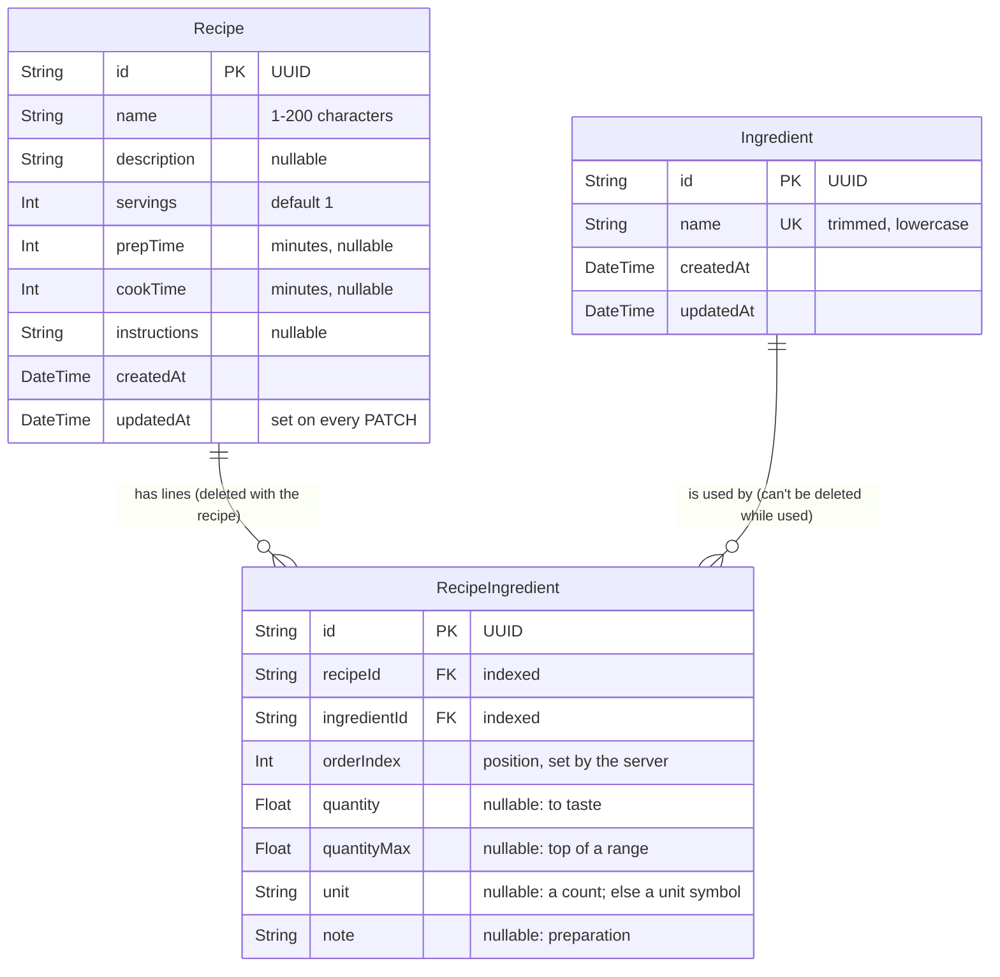

# Database schema (ERD)

The Phase 1 schema, from `prisma/schema.prisma`. GitHub draws the diagram below; in an editor, it needs a Mermaid preview. The reasons behind each field are in the technical spec, §2.1.

- `PK` is the primary key, `FK` a foreign key, and `UK` a unique column.
- A recipe has any number of lines, and each line uses one ingredient. The same ingredient can appear on several lines of one recipe.
- Deleting a recipe deletes its lines (cascade). Deleting an ingredient fails while any line uses it (restrict); the API returns 409.
- Both `name` columns also have a trigram (GIN) index for fuzzy search: `recipe_name_trgm_idx` and `ingredient_name_trgm_idx`.
- `unit` holds a symbol from `src/units.ts`, such as `g` or `tbsp`. See [the API reference](api.md#units) for the list.
